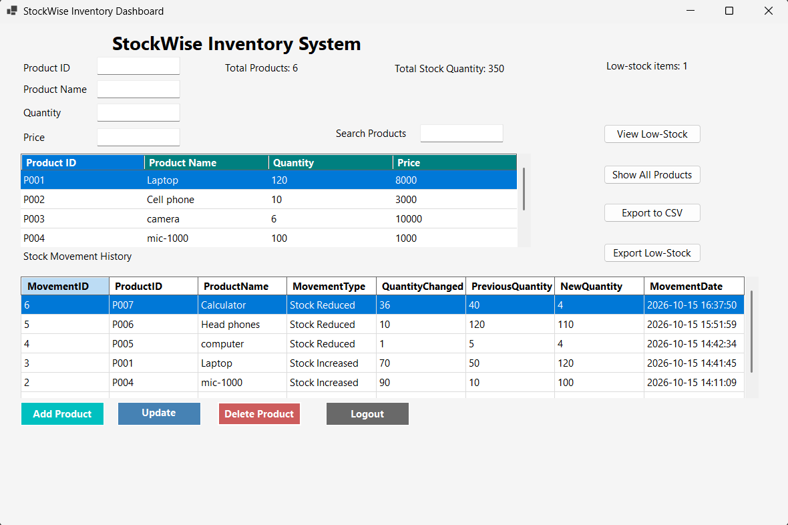

# StockWise Inventory Management System

A C# Windows Forms desktop application for managing inventory, tracking stock movements, identifying low-stock items, and exporting inventory reports using SQLite.

*The StockWise dashboard showing product inventory, stock movement history, and stock monitoring features.*

## Overview

StockWise is a desktop inventory management project built to demonstrate practical software development skills using C#, Windows Forms, and a relational database. It provides a graphical interface for maintaining product records and monitoring stock levels.

## Features

- **Product Management:** Add, update, and delete inventory products.
- **Persistent Data Storage:** Store product records in a SQLite database.
- **Inventory Dashboard:** View total product count and total stock quantity.
- **Product Search:** Search for products in the inventory.
- **Low-Stock Monitoring:** Identify products that may need restocking.
- **Stock Movement History:** Track recorded stock increases and reductions.
- **CSV Export:** Export inventory data and low-stock reports.
- **Input Validation:** Check required fields and validate quantity and price entries.
- **Login Screen:** Access the dashboard through the application login form.

## Technologies Used

- C#
- .NET Windows Forms
- SQLite
- SQL
- Visual Studio
- Git and GitHub

## Getting Started

### Prerequisites

- Windows
- Visual Studio with the .NET desktop development workload
- A compatible .NET SDK
- The SQLite package dependencies used by the project

### Installation

1. Clone or download this repository.
2. Open `StockWiseInventorySystem.sln` in Visual Studio.
3. Restore the project's NuGet packages if prompted.
4. Build the solution.
5. Run the application from Visual Studio.

### Login

The current development version uses hardcoded login credentials.

If the default credentials have not been changed in the source code, use:

- **Username:** `admin`
- **Password:** `1234`

These credentials are for demonstration only and should not be used in a production application.

## Project Structure

| File | Purpose |
|---|---|
| `Program.cs` | Application entry point |
| `Form1.cs` | Login form |
| `Dashboard.cs` | Main inventory dashboard and application logic |
| `Dashboard.Designer.cs` | Dashboard interface components |
| `DatabaseHelper.cs` | SQLite database operations |
| `StockWiseInventorySystem.csproj` | Project configuration |
| `StockWiseInventorySystem.sln` | Visual Studio solution |

## Skills Demonstrated

- C# desktop application development
- Event-driven programming
- CRUD operations (Create, Read, Update, Delete)
- SQL and SQLite database integration
- Data validation and exception handling
- DataGridView data presentation
- Searching, filtering, and reporting
- Exporting data to CSV
- Debugging and testing with Visual Studio
- Source control using GitHub

## Future Improvements

- Replace hardcoded login credentials with secure authentication.
- Add automated tests.
- Improve database configuration and deployment.
- Add role-based access control.
- Introduce inventory alerts and more detailed reporting.

## Project Status

Portfolio project — features and documentation are being refined.

## Getting Started

### Prerequisites

- Windows 10 or later
- Visual Studio 2022 or a compatible version with the .NET desktop development workload
- Git (optional, for cloning the repository)

### Installation

1. Clone or download this repository.
2. Open `StockWiseInventorySystem.slnx` in Visual Studio, or open the `.csproj` file if your Visual Studio version does not support `.slnx`.
3. Allow Visual Studio to restore the project dependencies.
4. Build the project using **Build > Build Solution**.
5. Run the application using **F5** or **Debug > Start Debugging**.

### Database

The application uses SQLite to store inventory records. The database is created by the application when its database initialization code runs. Keep the generated database file in the location expected by the application.

## Author

**NGUNEZI-bite**

GitHub repository: https://github.com/NGUNEZI-bite/stockwise-inventory-management-system
